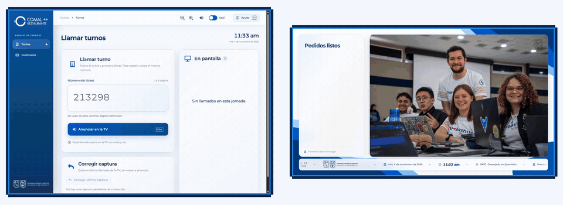
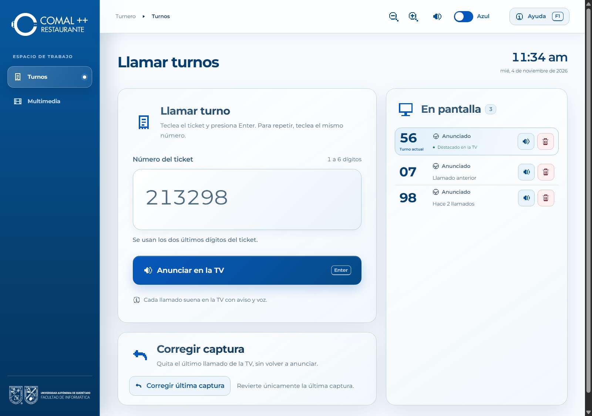
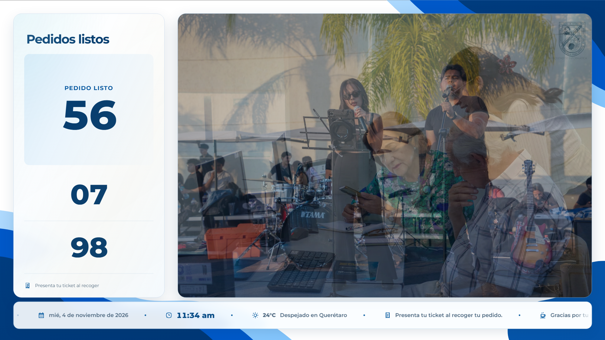
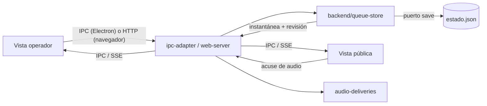

<div align="center">


# Comal++

### El siguiente pedido, en pantalla.

Sistema de turnos de **El Comal** para la **Facultad de Informática (FIF), Universidad Autónoma de Querétaro**.

Dos pantallas. Avisos por voz. Operación local.

[Demostración](#demostración) · [Propósito](#1-propósito) · [Arquitectura](#2-arquitectura) · [Pruebas](#9-pruebas) · [Reportar un problema](https://github.com/dmataguerra/comal-queue-system/issues)

[Integración continua](https://github.com/dmataguerra/comal-queue-system/actions/workflows/ci.yml) · [Publicaciones](https://github.com/dmataguerra/comal-queue-system/releases) · Windows x64 · [MIT](LICENSE)

</div>


## Demostración



**Una llamada, dos vistas sincronizadas.** La persona operadora captura el ticket; la pantalla pública presenta el pedido listo y el sistema reproduce su aviso por voz.

[Ver o descargar el video MP4](docs/readme/media/comal-dos-pantallas.mp4) · [Abrir la captura completa](docs/readme/media/dos-pantallas.png)

La vista previa muestra las dos ventanas reales con datos de demostración. El GIF y el video no incluyen audio.

|                    Estación de operación                    |                     Pantalla pública                      |
| :---------------------------------------------------------: | :-------------------------------------------------------: |
|     |  |

## Estado del documento

Este README es el documento maestro de estado del proyecto. Describe lo que el código y el repositorio contienen en la rama `chore/cleanup-architecture` (paquete `comal-local`, versión `1.0.0` en `package.json`). Los resultados de pruebas de la sección [Pruebas](#9-pruebas) corresponden a una ejecución concreta; todo lo que no se ejecutó se indica como tal.

## Contenido

1. [Propósito](#1-propósito)
2. [Arquitectura](#2-arquitectura)
3. [Requisitos e instalación para desarrollo](#3-requisitos-e-instalación-para-desarrollo)
4. [Scripts](#4-scripts)
5. [Build y publicación](#5-build-y-publicación)
6. [Configuración](#6-configuración)
7. [Audio](#7-audio)
8. [Registro (logging)](#8-registro-logging)
9. [Pruebas](#9-pruebas)
10. [Limitaciones conocidas y pendientes](#10-limitaciones-conocidas-y-pendientes)
11. [Documentación](#documentación)
12. [Contribuir](#contribuir) · [Colaboradores](#principales-colaboradores) · [Contacto](#contacto) · [Licencia](#licencia)

## 1. Propósito

Comal++ es una cola de pedidos listos para la cafetería de la FIF. Consta de:

- **Ventana del operador** (`views/operator`): la persona operadora captura entre uno y seis dígitos del ticket; el sistema usa los **dos últimos dígitos** (`00` a `99`) como número de turno (`core/turns.ts`). Permite repetir, deshacer y quitar llamados, administrar multimedia, ver diagnósticos y consultar la ayuda integrada.
- **Pantalla pública para TV** (`views/display`): muestra el turno actual y los turnos recientes, reproduce el aviso sonoro y la voz del número, y rota imágenes, videos locales o YouTube, además de reloj y mensajes.
- **Avisos por voz**: archivos WAV locales (`contenido/voz`, `contenido/aviso.wav`).
- **Multimedia**: imágenes y videos locales importados a la carpeta de datos; YouTube opcional.

Es una aplicación **local y sin base de datos**: el estado vive en archivos JSON dentro de la carpeta de datos del equipo. Los turnos, las voces y el contenido local funcionan sin internet; YouTube y el clima (`views/common/hooks/useWeather.ts`) dependen de servicios externos. El programa no registra ventas ni imprime tickets.

## 2. Arquitectura

Aplicación Electron con TypeScript (ES modules) y vistas en React. La lógica de turnos es pura y no depende de Electron.

### Estructura

| Carpeta / archivo | Responsabilidad |
| --- | --- |
| `core/` | Lógica pura de la cola, sin E/S. `turns.ts` (reglas de turnos: llamar, deshacer, quitar, vigencia), `playback-queue.ts` (cola de reproducción de anuncios), `youtube.ts` (reconocimiento y normalización de URL de YouTube). Cada módulo tiene pruebas `*.test.ts`. |
| `backend/queue-store.ts` | Almacén del estado de la cola. Es el único dueño del estado; recibe la persistencia por **puertos** (`load`, `save`, `ensureCapacity`, `today`, …), mantiene la **revisión** de la instantánea y notifica a los suscriptores. |
| `main/` | Proceso principal de Electron. `main.ts` es la entrada delgada. |
| `main/app/` | Composición: `bootstrap.ts` (arma y arranca todo), `env.ts` (lee variables de entorno una sola vez), `paths.ts` (rutas), `broadcaster.ts` (difusión a transportes), `config-service.ts`, `content-actions.ts`, `daily-reload.ts` (reinicio de jornada a la hora configurada), `health.ts` (salud de audio y YouTube), `electron-setup.ts`. |
| `main/` (módulos) | `store.ts` (une `backend/queue-store.ts` con `persistence.ts`), `persistence.ts` (lectura/escritura de `estado.json`), `atomic-write.ts`, `ipc-adapter.ts` e `ipc-validation.ts` (IPC y validación de entradas), `web-server.ts` y `main/web/` (servidor HTTP+SSE local: `api-routes.ts`, `sse.ts`, `request-guards.ts`, `static-files.ts`, `browser-inventory.ts`, `json-response.ts`, `types.ts`), `windows.ts`, `audio-deliveries.ts` (acuses de entrega de audio), `config.ts`, `data-folder.ts`, `logger.ts`, `content.ts` y `content-protocol.ts` (contenido local y protocolo `turnero://`), `csp-policy.ts`, `backup.ts`, `legacy-migration.ts`, `diagnostics.ts`, `preload.cts`, entre otros. |
| `shared/` | Código compartido entre procesos: `contract.ts` (tipos del contrato), `app-config.ts` (configuración tipada), `errors.ts` (códigos de error tipados), `logging.ts` (interfaz de logger), `announcement-policy.ts` (límites de la cola de anuncios), `ipc-channels.ts` (nombres de canales IPC). |
| `views/` | Interfaces React. `views/operator/` (con `hooks/`, `components/`, `help/`, `turns/`), `views/display/` (pantalla pública, con `content/`), `views/common/` (componentes, hooks, estilos y `transport.ts` compartidos). |
| `public/browser-transport.js` | Transporte HTTP + SSE para abrir las vistas en un navegador común en `127.0.0.1`; expone la misma API `window.turnero` que el preload de Electron. |

### Flujo de datos



1. La persona operadora ejecuta una acción (`LLAMAR`, `DESHACER`, `QUITAR`). La vista la envía por **IPC** (ventana Electron) o por **HTTP** `POST /api/accion` (navegador); ambas rutas validan la entrada (`main/ipc-validation.ts`) antes de llegar al almacén.
2. `backend/queue-store.ts` aplica la regla pura de `core/turns.ts` y guarda por el puerto `save`, que escribe `estado.json` de forma atómica. Si el guardado falla, la acción se rechaza con un error tipado y la cola no cambia.
3. El almacén notifica a sus suscriptores con la instantánea, el anuncio (si lo hay) y una **revisión** creciente. Las vistas descartan eventos de estado con revisión menor o igual a la ya aplicada (`InitialState.revision` en `shared/contract.ts`).
4. Los transportes difunden el estado a las dos vistas (IPC o SSE). La configuración, el contenido y las pantallas se difunden por `main/app/broadcaster.ts`.
5. **Acuses de entrega de audio.** Cada anuncio genera una entrega (`AudioDelivery`) cuyo estado es `pendiente`, `reproduciendo`, `reproducido`, `fallo` o `descartado`. La pantalla pública confirma con `confirmarAnuncio(id, n, estado)`; `main/audio-deliveries.ts` aplica los límites de `shared/announcement-policy.ts` (máximo 6 anuncios, espera máxima de 45 s, duración máxima de 30 s, historial de 100) y difunde cada cambio. Los acuses son del software; no comprueban la salida física de sonido.

## 3. Requisitos e instalación para desarrollo

- Windows (los scripts de empaquetado y firma lo requieren), **Node.js `>=22.13.0`** (campo `engines` de `package.json`), npm y Git.

```powershell
git clone https://github.com/dmataguerra/comal-queue-system.git
cd comal-queue-system
npm install      # o npm ci para respetar package-lock.json
npm run dev
```

`npm run dev` (`scripts/dev.mjs`) compila el proceso principal con `tsc`, deja `tsc --watch` y el servidor de Vite activos y abre Electron apuntando a `http://127.0.0.1:5173` mediante `TURNERO_DEV_URL`.

Para compilar y ejecutar la versión construida: `npm run build` y luego `npm start`.

## 4. Scripts

Todos los scripts de `package.json`:

| Script | Qué hace |
| --- | --- |
| `dev` | Modo desarrollo: compila el main, `tsc --watch`, Vite y Electron (`scripts/dev.mjs`). |
| `build` | Limpia `build/` (`scripts/prepare-build.mjs`), verifica tipos con `tsc --noEmit`, compila las vistas con `vite build` y el proceso principal con `tsc -p tsconfig.main.json`. |
| `start` | Ejecuta `electron .` sobre la compilación existente. |
| `test` | Verifica el audio y corre las pruebas unitarias con `tsx --test` sobre `core/*.test.ts`, `main/*.test.ts`, `main/app/*.test.ts` y `scripts/*-lifecycle.test.mjs`. |
| `verify:audio` | `node tooling/audio/verify-audio.mjs`: valida los WAV de `contenido/`. |
| `test:recovery` | `scripts/verify-recovery.mjs`: verificación de recuperación de datos. |
| `format` / `format:check` | Prettier (`--write` / `--check`) sobre `backend main core shared views scripts .github package.json .prettierrc.json`. |
| `lint` | ESLint sobre `backend main core shared views scripts vite.config.ts`. |
| `test:desktop` | Compila y ejecuta `scripts/smoke-desktop.mjs` en Electron. |
| `test:browser` | Compila y ejecuta `scripts/smoke-browser.mjs` (transporte de navegador). |
| `test:hardening` | Compila y ejecuta `scripts/smoke-hardening.mjs`. |
| `test:reload-race` | Compila y ejecuta `scripts/smoke-reload-race.mjs`. |
| `test:installed` | `scripts/smoke-installed.mjs`: valida el instalador ya generado (no compila). |
| `test:upgrade` | `scripts/smoke-upgrade.mjs`: prueba de actualización desde la línea base 0.2.0 (no compila). |
| `test:media` | Compila y ejecuta `scripts/smoke-media.mjs` (contenido multimedia local). |
| `test:full-day` | Compila y ejecuta `scripts/smoke-full-day.mjs`: prueba de jornada completa (390 min reales según `.github/workflows/release.yml`). |
| `test:full-day:preflight` | `electron scripts/smoke-full-day.mjs --preflight`: comprobación previa, sin compilar; no sustituye la jornada. |
| `test:theme` | Compila y ejecuta `scripts/smoke-theme.mjs`. |
| `test:interface` | Compila y ejecuta `scripts/smoke-interface.mjs`. |
| `test:help` | Compila y ejecuta `scripts/smoke-help.mjs` (centro de ayuda y recorridos). |
| `test:accessibility` | Compila y ejecuta `scripts/smoke-accessibility.mjs` (auditoría con axe-core). |
| `test:destructive` | Compila y ejecuta `scripts/smoke-destructive-regressions.mjs`. |
| `desktop:build` | Compila y genera el instalador NSIS para Windows (`scripts/package-desktop.mjs --win`). |
| `desktop:build:signed` | Igual, con `-c.win.forceCodeSigning=true` (exige firma). |
| `desktop:build:local-signed` | Igual, con `--firma-local` (certificado del almacén de Windows). |
| `desktop:dir` | Compila y genera solo la carpeta sin instalador (`--dir`). |

Scripts sin entrada en `package.json` que existen en `scripts/`: `smoke-audio-controls.mjs`, `smoke-background.mjs`, `smoke-display-scale.mjs` (se ejecutan con `npx electron scripts/<archivo>`, como en `.github/workflows/validate.yml`) y `data-cli.ts` (respaldo y restauración: `tsx scripts/data-cli.ts backup <datos> <destino>` o `restore <respaldo> <datos> --app-cerrada`).

## 5. Build y publicación

**Compilación.** `npm run build` produce `dist/` (vistas, Vite) y `build/` (proceso principal; `main` del paquete es `build/main/main.js`).

**Instalador.** `npm run desktop:build` compila y ejecuta `scripts/package-desktop.mjs --win`, que usa electron-builder con la configuración de `package.json`:

| Ajuste | Valor |
| --- | --- |
| `appId` / `productName` | `mx.uaq.comal.local` / `Comal++` |
| Destino | NSIS, arquitectura `x64`; salida en `release/` |
| NSIS | `oneClick: false`, `perMachine: false`, sin acceso directo en escritorio, con acceso en menú Inicio, permite cambiar la carpeta de instalación |
| `files` | `dist/**/*`, `build/**/*`, el icono `.ico`, `package.json`, `LICENSE` |
| `extraFiles` | carpeta `contenido` copiada a `contenido` junto al ejecutable (excluye `.gitkeep`); incluye las voces y `aviso.wav` |
| Ícono | `public/assets/branding/comal-trojan-helmet.ico` |

Variantes: `desktop:build:signed` (obliga a firmar), `desktop:build:local-signed` (firma con un certificado del usuario actual; exige `COMAL_SIGNING_CERT_SHA1` con la huella SHA-1 y valida con `scripts/verify-local-certificate.ps1` una clave RSA no exportable protegida por TPM), `desktop:dir` (sin instalador). `scripts/package-desktop.mjs` acepta `--publish never|always`. `scripts/verify-signatures.ps1` comprueba las firmas del instalador y de los ejecutables instalados. Guías: [firma local](docs/firma-local.md), [seguridad y publicación](docs/seguridad-y-publicacion.md), [lista de publicación](docs/lista-publicacion.md).

**Flujos de GitHub Actions** (`.github/workflows/`):

| Archivo | Disparador | Qué hace |
| --- | --- | --- |
| `ci.yml` | `pull_request`, `push` a `main`/`master`/`development`, manual | Llama a `validate.yml`. |
| `validate.yml` | `workflow_call` | Trabajo `quality` (format:check, lint, test, test:recovery, `npm audit --audit-level=high`); `baseline` (llama a `legacy-installer.yml`); `windows` (build, varios smoke de Electron, preflight de jornada, instalador sin firmar, `test:installed`, `test:upgrade`, sube el instalador probado y diagnósticos). |
| `legacy-installer.yml` | `workflow_call` | Construye el instalador 0.2.0 (commit fijo `7b10bb9…`) como línea base de actualización y registra su SHA256. |
| `cd.yml` | tags `v*`, manual | Ejecuta `validate.yml`; con tag `v*` y entorno `production`, verifica versión (`scripts/verify-release.mjs`), genera SBOM, empaqueta **instalador sin firma** (`COMAL_RELEASE_SIGNING: unsigned`), valida instalación y actualización, calcula SHA256 y publica un GitHub Release. |
| `release.yml` | manual | "Operational validation": ejecuta `npm run test:full-day` (390 min) en un runner autoalojado `comal-production` si se activa `full_day`. |

`scripts/verify-release.mjs` exige que el tag coincida con la versión de `package.json`; en modo firmado (`COMAL_RELEASE_SIGNING` distinto de `unsigned`) también exige los secretos `WIN_CSC_LINK`, `WIN_CSC_KEY_PASSWORD` y la variable `COMAL_SIGNER_SHA1`. La configuración vigente de `cd.yml` publica sin firma de editor; Windows puede mostrar advertencias de SmartScreen.

## 6. Configuración

### Valores fijos (`shared/app-config.ts`)

| Valor | Contenido |
| --- | --- |
| Servidor de desarrollo | `127.0.0.1:5173` |
| Servidor local para navegador | `127.0.0.1`, puerto por defecto **4317** |
| Protocolo interno | `turnero://app` |
| Archivos | `config.json`, `estado.json`, `turnero.log`, carpeta `contenido`; base heredada `comal.sqlite` y carpeta heredada `Turnero Comal` (solo para migración) |
| Barrido de entregas de audio | cada 250 ms |

Los nombres de archivos persistidos son parte del contrato en disco con instalaciones existentes.

### Variables de entorno

| Variable | Dónde se lee | Efecto |
| --- | --- | --- |
| `TURNERO_DEV_URL` | `main/app/env.ts`; la define `scripts/dev.mjs` | Origen del servidor Vite; las vistas se cargan desde ahí en vez de `turnero://app`. |
| `TURNERO_DATOS` | `main/app/env.ts`; la usan casi todos los `scripts/smoke-*.mjs` | Reemplaza la carpeta de datos (pruebas, instalaciones portátiles). |
| `TURNERO_PUERTO` | `main/app/env.ts` | Puerto del servidor local (entero 0–65535; `0` pide un puerto libre al sistema). Un valor inválido se ignora. |
| `TURNERO_MEDIA_MODE` | solo `scripts/smoke-media.mjs` | Con valor `built`, la prueba multimedia no usa `TURNERO_DEV_URL` (prueba la compilación). |
| `TURNERO_SMOKE_QUICK` | solo `scripts/smoke-desktop.mjs` | Con valor `1`, activa la ruta rápida de esa prueba. |
| `COMAL_SIGNING_CERT_SHA1` | `scripts/package-desktop.mjs` | Huella del certificado para `desktop:build:local-signed`. |
| `ELECTRON_BUILDER_CACHE` | `scripts/package-desktop.mjs` | Caché de electron-builder (por defecto `test-results/electron-builder-cache`). |
| `AZURE_SPEECH_KEY`, `AZURE_SPEECH_REGION`, `AZURE_SPEECH_ENDPOINT`, `ELEVENLABS_API_KEY` | `tooling/audio/generate-*.mjs` | Solo para regenerar audio; nunca se versionan. |

El proceso principal lee el entorno únicamente a través de `main/app/env.ts`.

### Carpeta de datos (`main/data-folder.ts`, `main/app/paths.ts`)

1. Si `TURNERO_DATOS` está definida, se usa esa ruta.
2. Si la aplicación está empaquetada: `<userData>/datos` (en producción normalmente `%APPDATA%/comal-local/datos`; la ruta efectiva aparece en **Ayuda → Diagnósticos**).
3. En desarrollo sin variable: la raíz del repositorio.

Contiene `config.json`, `estado.json`, `turnero.log` y `contenido/`. Al arrancar, una instalación empaquetada sin `TURNERO_DATOS` migra datos de `Documentos/Turnero Comal` si existen (`migrateDocumentsData`; copia, conserva los originales) y migra desde la base 0.2.0 `comal.sqlite` (`main/legacy-migration.ts`).

### `config.json` (`main/config.ts`)

Se crea con los valores por defecto si no existe. Claves desconocidas se ignoran con aviso; un valor inválido se reemplaza por el de defecto con aviso. El archivo se vigila y se recarga en caliente (espera de 300 ms; si el JSON es inválido se conserva la configuración anterior).

| Clave | Por defecto | Validación |
| --- | --- | --- |
| `youtubeUrl` | `null` | `null` o URL reconocida por `core/youtube.ts` |
| `repeticiones` | `1` | `1` o `2` |
| `volumenVoz` | `1` | número entre 0 y 3 |
| `volumenMusica` | `0.6` | número entre 0 y 1 |
| `atenuacionMusica` | `0.15` | número entre 0 y 1 |
| `segundosBanner` | `8` | entero entre 3 y 120 |
| `pantallaPublica` | `null` | `null` o entero (índice de pantalla preferida) |
| `recargaDiaria` | `"04:00"` | `HH:MM` de 24 h |
| `mensajes` | dos mensajes de ejemplo | arreglo de hasta 10 textos no vacíos, de hasta 160 caracteres |

Límites de importación de contenido (`main/content.ts`): videos hasta 2 GB, imágenes hasta 25 MB, reserva de disco de 512 MB. Estado: se rechaza guardar con menos de 16 MB libres (`main/store.ts`, error `DISK_FULL`).

## 7. Audio

- `contenido/voz/00.wav` a `99.wav` (100 voces, «Turno cero cero» a «Turno noventa y nueve») y `contenido/aviso.wav` (el tono que precede cada anuncio).
- **Solo WAV**: mono, 22 050 Hz, PCM de 16 bits. La aplicación ignora `.mp3` y el verificador falla si encuentra alguno.
- Secuencia en la pantalla pública: aviso, voz y, si `repeticiones` es 2, pausa de 300 ms y voz de nuevo.
- Verificación: `node tooling/audio/verify-audio.mjs` (o `npm run verify:audio`; también corre dentro de `npm test`). Con `--table` regenera el inventario [docs/audio/audio-inventory.md](docs/audio/audio-inventory.md).
- Herramientas de generación en `tooling/audio/`: `generate-announcements.ps1` + `synthesize.py` (Piper), `generate-azure.mjs`, `generate-elevenlabs.mjs`, `generate-chime.mjs`, `mp3-to-wav.mjs`. Procedimientos, parámetros y licencias en [tooling/audio/README.md](tooling/audio/README.md).
- Las 100 voces usan la misma voz. El turno 40 se obtuvo recortando «Turno cuarenta» de la grabación del 44, porque nunca existió un MP3 válido para ese número.

## 8. Registro (logging)

- Archivo `turnero.log` en la carpeta de datos (`main/logger.ts`).
- Formato: **JSON por línea** con los campos `time` (ISO), `level`, `component`, `version`, `session`, `message` y, si aplica, `context`.
- Niveles: `debug`, `info`, `warn`, `error` (`shared/logging.ts`). Los mensajes se limpian de saltos de línea y se cortan a 500 caracteres.
- **Rotación:** 5 MB por archivo, hasta 5 archivos (`turnero.log.1` … `turnero.log.5`).
- **Colapso de repetidos:** una entrada idéntica (mismo nivel, componente y mensaje) dentro de 30 s no se reescribe; al cambiar, se registra un resumen «Previous entry repeated N times.» con `context.repeated`.
- Las escrituras son síncronas y un fallo de registro nunca interrumpe la cola.
- Las vistas pueden enviar entradas al log del proceso principal (`registrar`).
- **Errores tipados** (`shared/errors.ts`): `AUDIO_QUEUE_FULL`, `STATE_SAVE_FAILED`, `DAY_ROLLOVER_FAILED`, `DISK_FULL`, `CONFIG_SAVE_FAILED`, `CONTENT_FOLDER_UNAVAILABLE`, `INVALID_REQUEST`, `UNAUTHORIZED`, `INTERNAL`. Un fallo que cruza IPC o HTTP se devuelve como `{ code, message }`, con `message` en español para la persona usuaria.

## 9. Pruebas

Comandos disponibles: ver la [tabla de scripts](#4-scripts). Base de validación: `npm run format:check`, `npm run lint`, `npm test`, `npm run build`; suites de Electron con `npm run test:*`; recuperación con `npm run test:recovery`.

### Ejecución verificada

Realizada el **2026-11-13** en esta rama (`chore/cleanup-architecture`), en Windows:

| Verificación | Resultado |
| --- | --- |
| `npm test` | 149 de 149 pruebas aprobadas |
| `npm run lint` | sin hallazgos |
| `npm run format:check` | sin hallazgos |
| `npm run build` | correcto |
| Suites de humo en Electron | aprobadas: `smoke-desktop`, `smoke-interface`, `smoke-help`, `smoke-accessibility`, `smoke-audio-controls`, `smoke-browser`, `smoke-hardening`, `smoke-reload-race`, `smoke-theme`, `smoke-background`, `smoke-display-scale`, `smoke-media` |
| `scripts/verify-recovery.mjs` | aprobado |

### No ejecutado en esta rama

- `npm run test:full-day` (prueba de resistencia de 6 horas / 390 min).
- `npm run test:installed`.
- `npm run test:upgrade`.
- `npm run test:destructive`.
- `npm run desktop:build` (generación del instalador).

Estos controles existen en el repositorio y en CI (`.github/workflows/validate.yml`, `release.yml`), pero **no se ejecutaron** como parte de esta verificación. Los resultados de pruebas anteriores, por ejemplo la [jornada del 2 de octubre de 2026](docs/resultado-jornada-2026-10-02.md) y el [informe QA](docs/qa-2026-11-03.md), conservan su propio contexto y no corresponden al estado actual del código.

## 10. Limitaciones conocidas y pendientes

| Tema | Detalle |
| --- | --- |
| **Nombres en español por compatibilidad** | Los nombres de propiedades en el cable y en disco siguen en español a propósito: tipos de `shared/contract.ts`, API `window.turnero`, claves de `config.json` y `estado.json`, canales IPC (`shared/ipc-channels.ts`, prefijo `turnero:`), identificadores de vista `'operador'` / `'publica'` y la URL `/publica`. Renombrarlos exige una API versionada o una migración. |
| **YouTube en navegador** | El modo de navegador simple no admite YouTube: `public/browser-transport.js` fija `youtubeAdmitido: false`; solo funciona en la aplicación de escritorio. |
| **Recarga de la pantalla en navegador** | La pantalla pública en un navegador simple no puede avisar al proceso principal de que se recarga, como sí lo hace la ventana de Electron (`onDisplayReplaced` en `main/windows.ts`, que reanuda las entregas de audio interrumpidas en `main/app/bootstrap.ts`). La recuperación de la carrera de recarga aplica a la pantalla de Electron. |
| **Tamaño del repositorio** | El historial de git aún contiene un instalador de 133 MB en la rama `release/0.3.1`. Pendiente de decisión. |
| **Prueba de 6 horas** | No se volvió a ejecutar después de esta refactorización. |
| **Navegador solo local** | El servidor para navegador escucha en `127.0.0.1` y no admite teléfonos ni otras computadoras (`main/web-server.ts`, `main/web/request-guards.ts`). |
| **Instalador sin firma de editor** | La configuración vigente de publicación (`.github/workflows/cd.yml`) genera un instalador sin firma digital de editor. |
| **Audio físico** | Los acuses de entrega son del software; no verifican que el sonido salga por las bocinas. La aceptación requiere comprobarlo en el local. |
| **Procedencia del audio** | El WAV no indica qué proveedor generó cada archivo; antes de distribuir debe verificarse procedencia y licencias ([tooling/audio/README.md](tooling/audio/README.md)). |
| **Documentos con nombres anteriores** | [docs/current-architecture.md](docs/current-architecture.md) todavía menciona rutas previas al renombrado (`nucleo/`, `vistas/comun/`, `main/persistencia.ts`); la fuente vigente de la estructura es esta sección 2. El manual PDF empaquetado es de la edición 0.4.0 (`shared/app-config.ts`, `manual`). |

## Documentación

| Quiero… | Documento |
| --- | --- |
| Aprender a utilizar el programa | [Manual del operador](docs/user-manual/operador.md) |
| Consultar el manual visual | [Manual PDF ilustrado, edición 0.4.0](output/pdf/Comal++_Manual_de_usuario_0.4.0.pdf) |
| Tener una referencia breve en mostrador | [Guía rápida del cajero](docs/user-manual/Guia-Rapida-Cajero.pdf) |
| Instalar desde una memoria USB | [Instalación y puesta en marcha](README-INSTALACION-USB.md) |
| Consultar requisitos funcionales | [Casos de uso](docs/casos-de-uso.md) |
| Ver el diseño (puede usar nombres anteriores) | [Arquitectura](docs/current-architecture.md) |
| Respaldar o recuperar datos | [Operación y recuperación](docs/operacion-recuperacion.md) |
| Conocer la ayuda integrada | [Centro de ayuda interactivo](docs/centro-ayuda-interactivo.md) |
| Revisar seguridad y distribución | [Seguridad y publicación](docs/seguridad-y-publicacion.md) · [Firma local](docs/firma-local.md) |
| Preparar una entrega | [Lista de publicación](docs/lista-publicacion.md) · [CI/CD](docs/CI-CD.md) |
| Revisar el audio | [Inventario de audio](docs/audio/audio-inventory.md) · [Herramientas de audio](tooling/audio/README.md) |
| Revisar cambios | [Historial](CHANGELOG.md) · [Notas 1.0.0](docs/publicacion-1.0.0.md) |
| Explorar todos los documentos | [Índice de documentación](docs/README.md) · [Documentación técnica PDF](docs/technical-documentation.pdf) |

Los documentos fechados y los manuales con número de versión conservan su contexto original.


## Contribuir

Las mejoras, correcciones y propuestas de documentación son bienvenidas.

1. Revisa los [issues](https://github.com/dmataguerra/comal-queue-system/issues) y crea una rama desde la base actual.
2. Mantén el cambio enfocado y actualiza la documentación cuando cambie el comportamiento.
3. Ejecuta formato, lint, pruebas y compilación; añade las verificaciones del área afectada.
4. Crea commits atómicos con mensajes que describan el cambio.
5. Abre un pull request con el problema, el resultado esperado y la evidencia de validación.

Los cambios de persistencia, comunicación entre procesos, seguridad, audio y empaquetado requieren atención a las regresiones y la recuperación de datos.

## Principales colaboradores

Gracias a quienes han contribuido al código y a la evolución del proyecto.

| Colaborador | Perfil |
| ----------- | ---------------------------------------------- |
| dmataguerra | [@dmataguerra](https://github.com/dmataguerra) |
| Alexiiis21  | [@Alexiiis21](https://github.com/Alexiiis21)   |

[Consultar todas las contribuciones](https://github.com/dmataguerra/comal-queue-system/graphs/contributors)

## Contacto

- [dmataguerra@outlook.com](mailto:dmataguerra@outlook.com)
- [acardenas22@alumnos.uaq.mx](mailto:acardenas22@alumnos.uaq.mx)

## Licencia

El código propio se distribuye bajo la [licencia MIT](LICENSE). Los recursos institucionales, el contenido multimedia y las dependencias de terceros conservan sus derechos y licencias correspondientes.

<div align="center">

**Comal++ · Facultad de Informática · UAQ**

[Volver al inicio](#comal)

</div>
